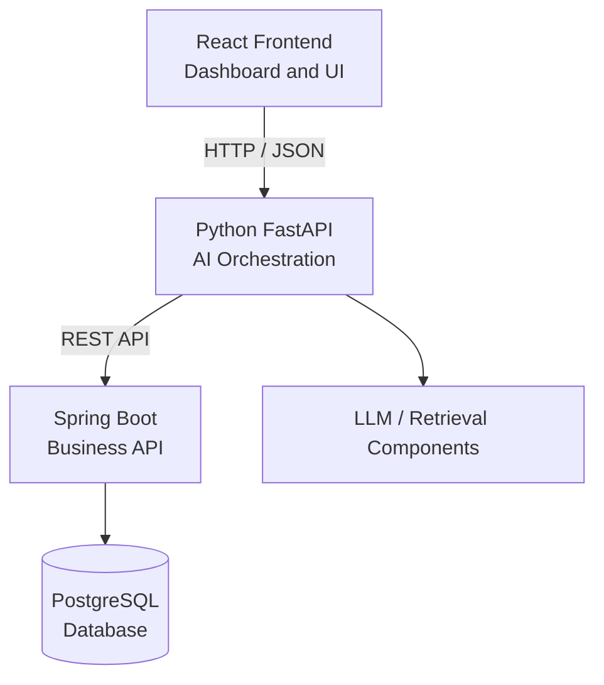

# EnterpriseOps AI — Frontend

<p align="center">
  
  
  
  
</p>

<p align="center">
  <strong>An AI-assisted operations dashboard for customer support, order investigation, and human-reviewed workflows.</strong>
</p>

<p align="center">
  <a href="https://github.com/vishwajeethshikari">GitHub Profile</a>
</p>

---

## Overview

**EnterpriseOps AI** is an AI-assisted business operations platform designed to help support teams investigate customer orders, retrieve relevant policies, analyze operational issues, and review proposed actions in a centralized workspace.

The frontend provides the user interface for interacting with the platform's backend services. It is designed to connect a React-based dashboard with a Python FastAPI orchestration layer and a Spring Boot business API.

The project focuses on bringing together **AI orchestration, business data, backend integration, and human oversight** in one application.

> **Project status:** Active development. Feature availability depends on the current implementation and integration status of the frontend and backend services.

## Key Capabilities

The following are the intended capabilities of the application; verify each against the current source code before describing it as implemented.

- **Dashboard:** A centralized workspace for operational information and system activity.
- **Order Investigation:** Retrieve and inspect order information using order identifiers such as `ORD-1042`.
- **AI-Assisted Analysis:** Present findings generated by the backend's AI orchestration layer.
- **Policy Retrieval:** Support policy-related questions using information retrieved by backend services.
- **Agent Findings:** Organize results from investigation, retrieval, and issue-triage workflows.
- **Workflow Review:** Display proposed business actions for review and approval where supported.
- **API Integration:** Communicate with backend services through HTTP APIs.
- **Responsive UI:** Provide a consistent interface across supported screen sizes.

## Technology Stack

| Technology | Purpose |
|---|---|
| React | Component-based user interface |
| TypeScript | Type-safe application development, where configured |
| Vite | Development server and production build |
| Axios | HTTP communication with backend APIs |
| Lucide React | Interface icons, if used in the source |
| CSS | Layout, styling, and responsive design |

The repository's `package.json` and actual source files are the source of truth for the installed dependencies and implementation.

## System Architecture



### Request Flow

1. A user interacts with the React dashboard.
2. The frontend sends a request to the Python FastAPI service.
3. FastAPI coordinates the relevant AI or retrieval workflow.
4. When business data or operations are required, the orchestration layer communicates with the Spring Boot API.
5. Spring Boot handles business logic and database access.
6. The resulting information is returned to the frontend for presentation.

**Architecture principle:** The frontend should not connect directly to PostgreSQL. Business logic, data access, authorization, and sensitive operations belong in the backend services.

The diagram represents the intended architecture. Confirm the actual request paths and integrations in the current implementation.

## Project Structure

The exact structure may differ depending on the current branch.

```text
enterpriseops-ai-frontend/
├── public/
│   └── assets/
├── src/
│   ├── api/             # API clients and request helpers
│   ├── components/      # Reusable UI components
│   ├── pages/           # Dashboard and feature screens
│   ├── App.tsx          # Root application component
│   ├── App.css          # Application styles
│   ├── index.css        # Global styles
│   └── main.tsx         # Application entry point
├── index.html
├── package.json
├── tsconfig.json
├── vite.config.ts
└── README.md
```

*Use the actual repository files as the source of truth. Do not create duplicate entry points or folders solely to match this example.*

## Getting Started

### Prerequisites

- [Node.js](https://nodejs.org/)
- npm
- The Python FastAPI service for integrated AI functionality
- The Spring Boot business service for supported business operations

### 1. Clone the Repository

```bash
git clone https://github.com/vishwajeethshikari/enterpriseops-ai-frontend.git
cd enterpriseops-ai-frontend
```

### 2. Install Dependencies

```bash
npm install
```

If a package imported by the source code is missing, install it only after checking `package.json`.

For example, if Axios and Lucide React are required but not installed:

```bash
npm install axios lucide-react
```

### 3. Start the Development Server

```bash
npm run dev
```

Open the local URL printed in the terminal. With the default Vite configuration, this is commonly:

```text
http://localhost:5173
```

### 4. Build for Production

```bash
npm run build
```

A successful build should complete without errors. Use the repository's configured preview command to inspect the production build locally, if available.

## Backend Integration

The documented local development configuration uses these service addresses:

| Service | Local URL | Responsibility |
|---|---|---|
| Frontend | `http://localhost:5173` | User interface |
| FastAPI | `http://localhost:8000` | AI orchestration and retrieval |
| Spring Boot | `http://localhost:8080` | Business logic and data access |
| PostgreSQL | Backend-configured | Persistent storage |

These URLs are expected local defaults, not a guarantee that every service is running or reachable.

### Integration Checklist

- Start the required backend services.
- Verify the API routes and request/response formats.
- Check the Vite proxy configuration before relying on a particular API prefix.
- Confirm that the frontend can reach FastAPI.
- Verify that FastAPI can reach the Spring Boot service.
- Handle loading, success, empty, and error states in the interface.
- Configure CORS or a development proxy as required.

Keep environment-specific configuration outside the application logic. Never commit secrets, database credentials, or private API keys to the frontend repository.

## Available Scripts

Check `package.json` for the scripts supported by the current branch.

Common Vite scripts include:

```bash
npm run dev
npm run build
npm run preview
```

Run the following command to list the available npm scripts:

```bash
npm run
```

## Security and Human Approval

EnterpriseOps AI is designed around AI-assisted decision support rather than unrestricted autonomous execution.

- Treat AI-generated recommendations as proposals, not verified facts.
- Enforce authentication and authorization in the backend.
- Validate all sensitive business operations on the server.
- Require appropriate human approval for consequential actions.
- Avoid exposing credentials, private data, or internal service secrets in the browser.
- Do not rely on frontend-only checks as security controls.

The interface should clearly distinguish AI-generated findings from confirmed business records and approved actions.

## Roadmap

Potential improvements, subject to project priorities:

- [ ] Verify end-to-end order investigation.
- [ ] Integrate the dashboard with actual backend responses.
- [ ] Connect policy retrieval and agent findings to implemented API endpoints.
- [ ] Display workflow status and approval outcomes.
- [ ] Improve loading, error, and empty states.
- [ ] Add frontend tests and accessibility checks.
- [ ] Validate environment configuration and production builds.
- [ ] Document verified API contracts and deployment instructions.

## Contributing

1. Create a feature branch.
2. Make focused changes that follow the existing project structure.
3. Run the available tests and production build.
4. Submit a pull request describing the changes and validation performed.

## Author

**Vishwajeeth Shikari**

- GitHub: [@vishwajeethshikari](https://github.com/vishwajeethshikari)

---

<p align="center">
  <strong>EnterpriseOps AI</strong><br/>
  AI-assisted operations. Business-aware workflows. Human-reviewed decisions.
</p>
